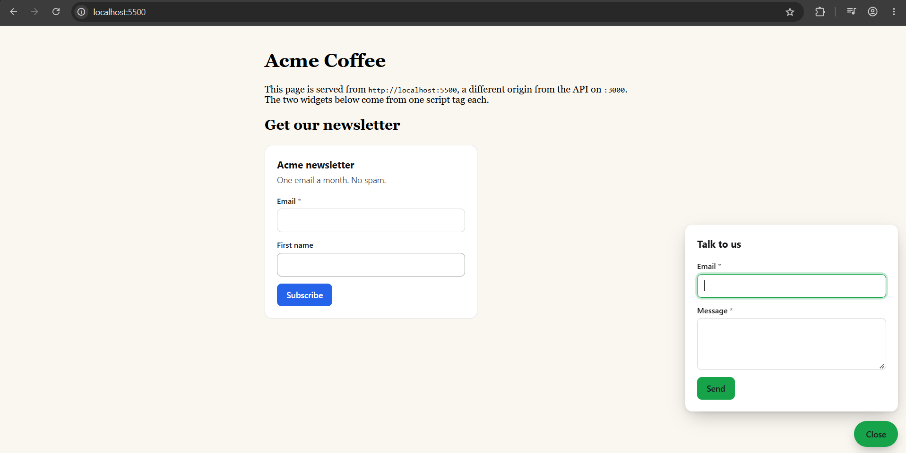

# EVIDENCE

Real output captured on 2026-11-17 against `docker compose up` + `npm run seed` (`GEO_MODE=mock`, `DEV_TOOLS=true`).
Shorthand used below: `$W` = `11111111-…` (Acme newsletter), `$C` = `22222222-…` (Acme contact form),
`$O` = `Origin: http://localhost:5500`, `$J` = `Content-Type: application/json`.

## Automated suite (`docker compose exec -T api npm test`)
```
ok 1 - admin API rejects missing and invalid keys
ok 2 - widget CRUD with validation and embed snippet
ok 3 - tenant isolation: B cannot read, modify or delete A's widget or see A's submissions
ok 4 - public config: small, cached, CORS-enabled; unknown ids 404
ok 5 - widget.js: versioned URL is immutable, unversioned is short-lived
ok 6 - CORS preflight (OPTIONS) is answered
ok 7 - PROBE 1: valid cross-origin submission → 201, stored, visible in dashboard API
ok 8 - PROBE 2: malformed and oversized payloads → clean 4xx JSON, never 500
ok 9 - PROBE 6: honeypot filled → silently dropped, nothing stored
ok 10 - PROBE 4: provider A down → enriched by B; both down → stored without geo
ok 11 - PROBE 5: email side effect throws → submission still 201 and stored
ok 12 - idempotency: same Idempotency-Key twice → stored once
ok 13 - PROBE 3: burst → 429s, service keeps serving legitimate traffic
# tests 13
# pass 13
# fail 0
```

---

## Widget management

### ☑ Authenticated CRUD; requests without valid auth are rejected
Test 1 and 2 above. Manual:
```
$ curl -s -o /dev/null -w '%{http_code}\n' http://localhost:3000/v1/admin/widgets
401
$ curl -s -H 'Authorization: Bearer wrong' http://localhost:3000/v1/admin/widgets
{"error":{"code":"unauthorized","message":"Missing or invalid API key"}}
```

### ☑ Multi-tenant isolation: tenant A cannot read or modify tenant B's widgets or submissions
Tenant B's key against tenant A's widget (test 3 also checks B's submission list never contains A's rows):
```
$ curl -s -H 'Authorization: Bearer demo-key-tenant-b' http://localhost:3000/v1/admin/widgets/$W
{"error":{"code":"not_found","message":"Widget not found"}}
$ curl -s -X PATCH -H 'Authorization: Bearer demo-key-tenant-b' -H "$J" -d '{"title":"pwned"}' http://localhost:3000/v1/admin/widgets/$W
{"error":{"code":"not_found","message":"Widget not found"}}
$ curl -s -X DELETE -o /dev/null -w '%{http_code}\n' -H 'Authorization: Bearer demo-key-tenant-b' http://localhost:3000/v1/admin/widgets/$W
404
```

### ☑ Embed snippet generated per widget
```
$ curl -s -w ' [%{http_code}]\n' -H 'Authorization: Bearer demo-key-tenant-a' -H "$J" -d '{"type":"signup","title":"Evidence widget","fields":[{"name":"email","label":"Email","type":"email","required":true}]}' http://localhost:3000/v1/admin/widgets
{"id":"b4470429-9274-4849-b8d7-cbc9db85ed90","type":"signup","title":"Evidence widget","description":null,"fields":[{"name":"email","type":"email","label":"Email","required":true,"maxLength":200}],"buttonText":"Submit","display":{"position":"inline","accentColor":"#2563eb"},"createdAt":"2026-11-17T12:26:04.666Z","updatedAt":"2026-11-17T12:26:04.666Z","embed":"<script async src=\"http://localhost:3000/widget.js?id=b4470429-9274-4849-b8d7-cbc9db85ed90&v=8cdd07b9851c\"></script>"} [201]
```

## Widget delivery

### ☑ Public config endpoint: small payload, correct cache headers
```
$ curl -s -i -H "$O" http://localhost:3000/v1/widgets/$W/config
HTTP/1.1 200 OK
Access-Control-Allow-Origin: *
Cache-Control: public, max-age=60
Content-Length: 386
ETag: W/"182-GAVoNEwtAicMCIyxTOE/Wi974M4"
```

### ☑ Widget JavaScript served as a versioned bundle
The `v` in the snippet is a sha256 prefix of the bundle. A new release gets a new URL.
```
$ curl -s -I 'http://localhost:3000/widget.js?id=$W&v=8cdd07b9851c'
HTTP/1.1 200 OK
Cache-Control: public, max-age=31536000, immutable
Content-Type: application/javascript; charset=utf-8
$ curl -s -I 'http://localhost:3000/widget.js?id=$W'
HTTP/1.1 200 OK
Cache-Control: public, max-age=300
```

### ☑ The widget renders on a page served from a different origin
`http://localhost:5500` (nginx `site` container) loads both seeded widgets from `http://localhost:3000`.
In the browser both render (inline newsletter + floating contact form), and a real form submit shows
"Thanks! We got it." with no console errors.



## Public submission API

### ☑ Cross-origin submissions work: CORS headers correct, preflight handled
```
$ curl -s -i -X OPTIONS -H "$O" -H 'Access-Control-Request-Method: POST' -H 'Access-Control-Request-Headers: content-type,idempotency-key' http://localhost:3000/v1/widgets/$W/submissions
HTTP/1.1 204 No Content
Access-Control-Allow-Origin: *
Access-Control-Allow-Methods: GET, POST, OPTIONS
Access-Control-Allow-Headers: Content-Type, Idempotency-Key
Access-Control-Expose-Headers: Retry-After
Access-Control-Max-Age: 600
```

### ☑ All input validated; malformed and oversized payloads → 4xx JSON
```
$ curl -s -w ' [%{http_code}]\n' -H "$O" -H "$J" -d '{"fields": {' http://localhost:3000/v1/widgets/$W/submissions
{"error":{"code":"malformed_json","message":"Request body is not valid JSON"}} [400]
$ curl -s -w ' [%{http_code}]\n' -H "$O" -H "$J" --data-binary @big.json http://localhost:3000/v1/widgets/$W/submissions   # 20 KB body
{"error":{"code":"payload_too_large","message":"Request body is too large"}} [413]
$ curl -s -w ' [%{http_code}]\n' -H "$O" -H "$J" -d '{"fields":{"email":"not-an-email","admin":true}}' http://localhost:3000/v1/widgets/$W/submissions
{"error":{"code":"validation_failed","message":"Request validation failed","details":[{"path":"email","message":"Invalid email"},{"path":"","message":"Unrecognized key(s) in object: 'admin'"}]}} [400]
```

### ☑ Valid submissions stored, linked to the right widget and tenant (PROBE 1)
```
$ curl -s -w ' [%{http_code}]\n' -H "$O" -H "$J" -d '{"fields":{"email":"ada@example.com","name":"Ada"}}' http://localhost:3000/v1/widgets/$W/submissions
{"id":"728a32ca-e80c-4118-a82e-8e749662f246","geo":{"country":"DE","city":"Berlin","provider":"ip-api.com"},"replay":false} [201]
$ curl -s -H 'Authorization: Bearer demo-key-tenant-a' 'http://localhost:3000/v1/admin/submissions?limit=1'
{"data":[{"id":"728a32ca-e80c-4118-a82e-8e749662f246","widgetId":"11111111-1111-4111-8111-111111111111","data":{"name":"Ada","email":"ada@example.com"},"geo":{"country":"DE","city":"Berlin","provider":"ip-api.com"},"createdAt":"2026-11-17T12:11:01.826Z"}]}
```

## Abuse protection

### ☑ Rate limiting returns 429 under a burst, API keeps serving (PROBE 3)
30 rapid submissions to the contact widget (limit: 20 per IP+widget per 10 s), then a normal request:
```
$ for i in $(seq 1 30); do curl -s -o /dev/null -w '%{http_code} ' ... /v1/widgets/$C/submissions; done
201 201 201 201 201 201 201 201 201 201 201 201 201 201 201 201 201 201 201 201 429 429 429 429 429 429 429 429 429 429
$ curl -s -i ... /v1/widgets/$C/submissions
HTTP/1.1 429 Too Many Requests
Retry-After: 9
{"error":{"code":"rate_limited","message":"Too many requests, please slow down"}}
$ curl -s -w ' [%{http_code}]\n' -H "$O" -H "$J" -d '{"fields":{"email":"normal@example.com"}}' http://localhost:3000/v1/widgets/$W/submissions
{"id":"db362498-2e8e-480c-8b76-9f9df4d7092e","geo":{"country":"DE","city":"Berlin","provider":"ip-api.com"},"replay":false} [201]
```

### ☑ Spam prevention (honeypot) blocks a spam submission (PROBE 6)
```
$ curl -s -w ' [%{http_code}]\n' -H "$O" -H "$J" -d '{"fields":{"email":"bot@spam.test"},"hp":"http://spam.test"}' http://localhost:3000/v1/widgets/$W/submissions
{"ok":true} [202]
$ curl -s -H 'Authorization: Bearer demo-key-tenant-a' '.../v1/admin/submissions?limit=200' | grep -c bot@spam.test
0
```

## Enrichment & safe side effects

### ☑ Provider A down → provider B answers → submission enriched (PROBE 4)
```
$ curl -s -H "$J" -d '{"geoA":"down"}' http://localhost:3000/dev/toggles
{"geoA":"down","geoB":"up","email":"ok"}
$ curl -s -w ' [%{http_code}]\n' -H "$O" -H "$J" -d '{"fields":{"email":"geo-b@example.com"}}' http://localhost:3000/v1/widgets/$W/submissions
{"id":"3e2ef715-222d-4a98-9273-aa90c4e2f752","geo":{"country":"NL","city":"Amsterdam","provider":"ipapi.co"},"replay":false} [201]
```

### ☑ All providers down → submission still succeeds without geo
```
$ curl -s -H "$J" -d '{"geoB":"down"}' http://localhost:3000/dev/toggles
{"geoA":"down","geoB":"down","email":"ok"}
$ curl -s -w ' [%{http_code}]\n' -H "$O" -H "$J" -d '{"fields":{"email":"geo-none@example.com"}}' http://localhost:3000/v1/widgets/$W/submissions
{"id":"33b38172-2cdf-4dfd-b783-022dc13a9fc4","geo":null,"replay":false} [201]
```
Server log: `[geo] ip-api.com failed: provider disabled (toggle)` / `[geo] ipapi.co failed: provider disabled (toggle)`

### ☑ Failing email does not prevent the submission from being stored (PROBE 5)
The email is a background job, retried with backoff, then raised as an alert:
```
$ curl -s -H "$J" -d '{"email":"fail"}' http://localhost:3000/dev/toggles
{"geoA":"up","geoB":"up","email":"fail"}
$ curl -s -w ' [%{http_code}]\n' -H "$O" -H "$J" -d '{"fields":{"email":"email-down@example.com"}}' http://localhost:3000/v1/widgets/$W/submissions
{"id":"488af9b7-4c30-4eb7-a4cd-1281542e1a1c","geo":{"country":"DE","city":"Berlin","provider":"ip-api.com"},"replay":false} [201]
$ docker compose logs --since 30s api | grep -E 'will retry|ALERT'
api-1  | [worker] job 32 attempt 1 failed, will retry: SMTP unavailable (simulated via /dev/toggles)
api-1  | [worker] job 32 attempt 2 failed, will retry: SMTP unavailable (simulated via /dev/toggles)
api-1  | [ALERT] job 32 (notify_owner) failed permanently after 3 attempts: SMTP unavailable (simulated via /dev/toggles)
```

## Shared requirements

### Idempotency: a retried submission is stored once
```
$ curl ... -H 'Idempotency-Key: evidence-key-0001' -d '{"fields":{"email":"idem@example.com"}}' .../v1/widgets/$W/submissions   (x2)
{"id":"4939f96a-46bb-4a30-92ca-c6a0a35d16a8","geo":{...},"replay":false} [201]
{"id":"4939f96a-46bb-4a30-92ca-c6a0a35d16a8","geo":{...},"replay":true} [200]
```

### Dashboard stats (aggregation queries)
```
$ curl -s -H 'Authorization: Bearer demo-key-tenant-a' http://localhost:3000/v1/admin/stats
{"days":30,"perDay":[{"day":"2026-11-17","count":54}],"perWidget":[{"widgetId":"22222222-…","title":"Talk to us","count":40,…},{"widgetId":"11111111-…","title":"Acme newsletter","count":14,…},{"widgetId":"6d37a9b8-…","title":"Evidence widget","count":0,"lastSubmissionAt":null}],"byCountry":[{"country":"DE","count":50},{"country":"NL","count":2},{"country":"unknown","count":2}]}
```

## Documentation
### ☑ README with architecture diagram, setup, API docs; required files present
`README.md`, `DESIGN.md`, `capstone.yaml`, `EVIDENCE.md`, `BUILDLOG.md`, `.env.example`, `LICENSE`.
